# Coffee Delivery

SPA de e-commerce de cafés feita como **projeto final da disciplina Single Page Application**. O usuário navega pelo catálogo, monta o carrinho, informa o endereço com **consulta real à ViaCEP**, escolhe uma forma de pagamento fictícia e recebe a confirmação do pedido. Há tema claro e escuro, layout responsivo e foco em acessibilidade.

> **Aplicação publicada:** _a publicar (TASK-030)_ · **Figma:** [Coffee Delivery • Projeto Final React](https://www.figma.com/design/DBM8Ky5Qy7ZUOP2pUR5SrJ/Coffee-Delivery-%E2%80%A2-Projeto-Final-React--c%C3%B3pia-?node-id=0-1)

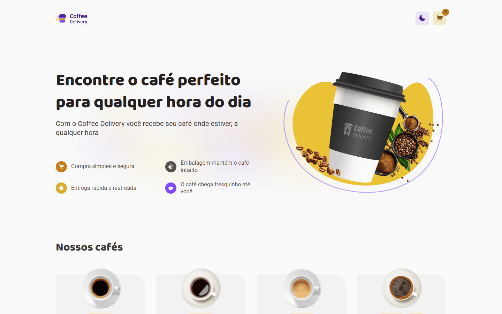

## Sumário

- [Funcionalidades](#funcionalidades)
- [Screenshots](#screenshots)
- [Stack](#stack)
- [Como executar](#como-executar)
- [Arquitetura](#arquitetura)
- [Decisões de projeto](#decisões-de-projeto)
- [Qualidade e testes](#qualidade-e-testes)
- [Marca e Branding com IA](#marca-e-branding-com-ia)
- [Uso de IA no desenvolvimento](#uso-de-ia-no-desenvolvimento)
- [Documentação](#documentação)
- [Limitações conhecidas](#limitações-conhecidas)

## Funcionalidades

| Requisito | O que a aplicação faz |
|---|---|
| RF-01, RF-02 | Catálogo com os 14 cafés do Figma; quantidade escolhida antes de adicionar (mínimo 1). |
| RF-03, RF-04 | Adicionar o mesmo café soma na mesma linha; o badge do Header soma **unidades**. |
| RF-05 | No checkout: aumentar, diminuir (de 1 para 0 remove) e remover itens. |
| RF-06 | Carrinho salvo no `localStorage`; dados corrompidos não quebram o app. |
| RF-07 | Rotas `/`, `/checkout` e `/success` sem recarregar a página. |
| RF-08 | CEP consultado na **ViaCEP**: rua, bairro, cidade e UF preenchidos; número e complemento manuais; CEP inválido, não encontrado, lentidão e falha de rede tratados, com preenchimento manual. |
| RF-09 | Crédito, débito ou dinheiro, apenas informativo (nenhum dado de cartão). |
| RF-10 | Subtotal, frete fixo de **R$ 3,50** e total, calculados em centavos. |
| RF-11 | Confirmação bloqueada com carrinho vazio ou formulário inválido, com erros acessíveis. |
| RF-12, RF-13 | Pedido salvo como **snapshot** antes de limpar o carrinho; a tela de sucesso continua correta após refresh. |
| RF-14 | Tema claro/escuro persistido, seguindo o sistema na primeira visita, sem "piscar". |
| RF-15 | Layout mobile-first verificado de 320 a 1440 px. |
| RF-16 | Logo no Header e favicon (**provisórios em SVG**; a versão final com IA está na TASK-032). |

## Screenshots

| | Claro | Escuro |
|---|---|---|
| **Home (mobile)** | 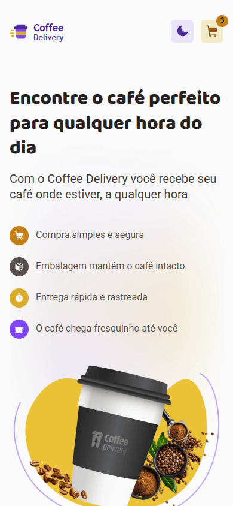 | 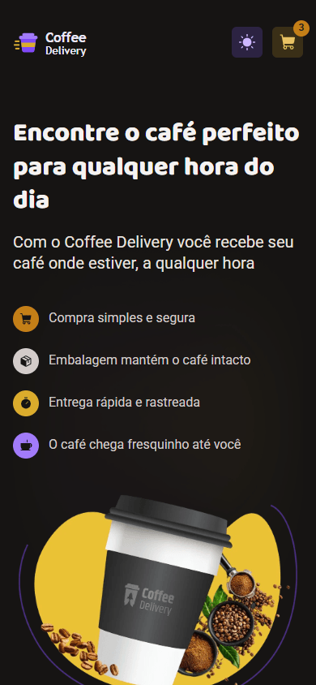 |
| **Checkout (mobile)** | 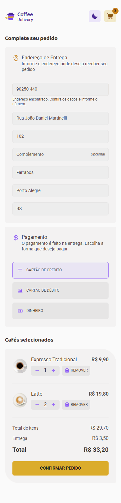 | 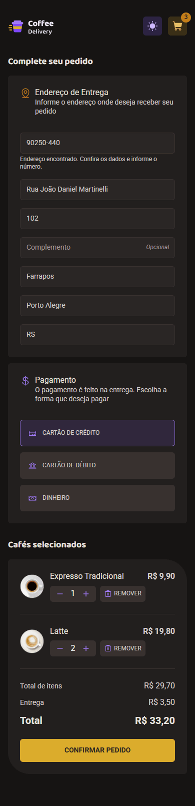 |
| **Sucesso (mobile)** | 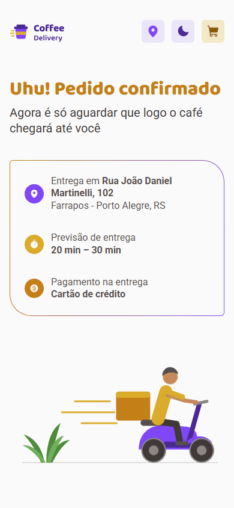 | 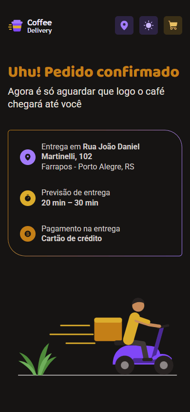 |

<details>
<summary>Desktop (1440 px)</summary>

| Claro | Escuro |
|---|---|
|  | 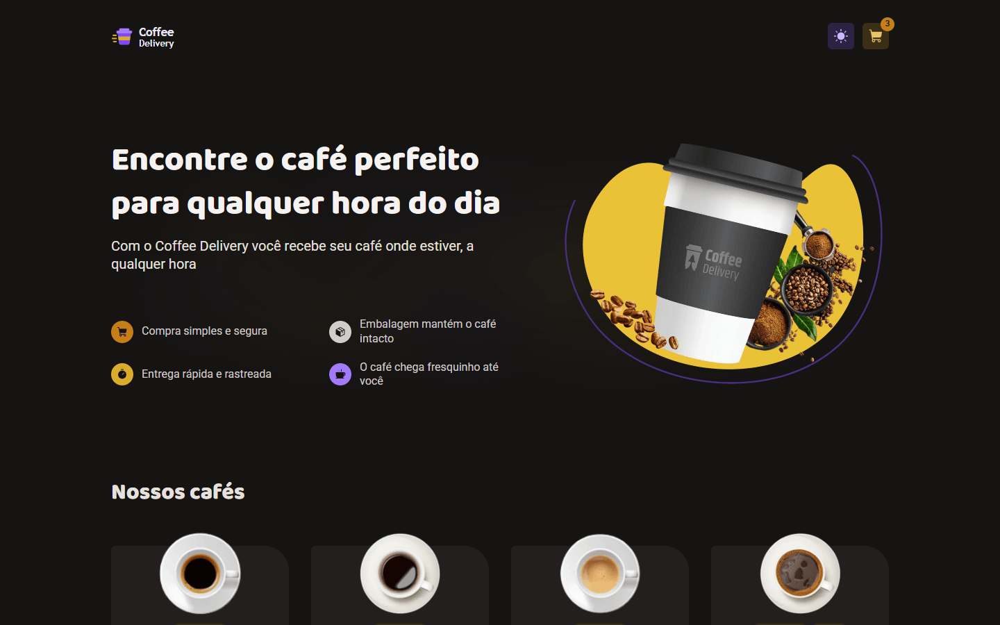 |
| 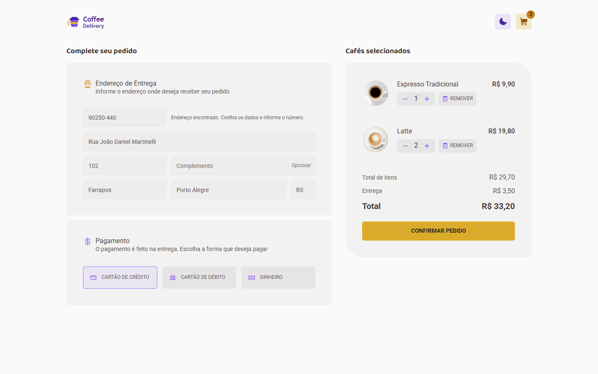 | 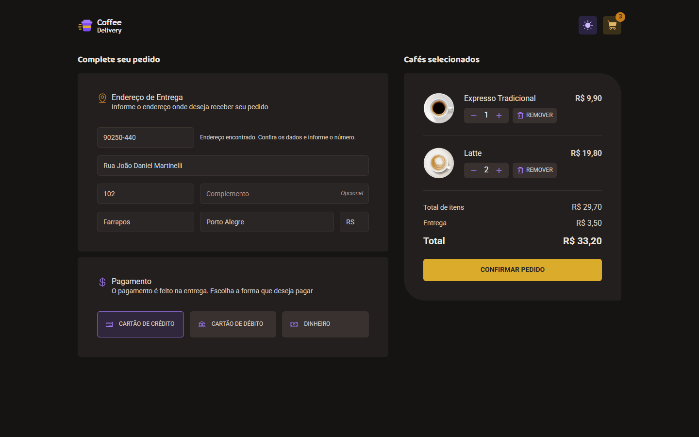 |
| 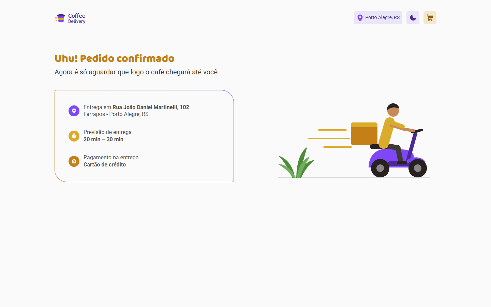 | 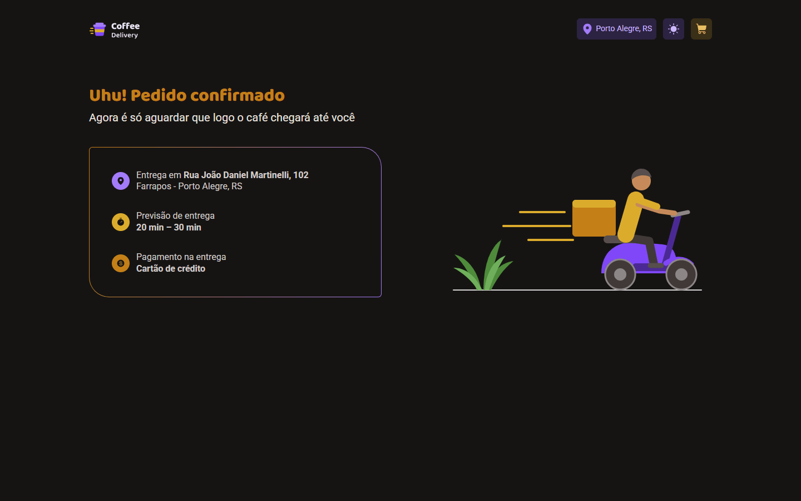 |

</details>

As telas de checkout foram capturadas com o endereço preenchido pela ViaCEP real (CEP do Figma, `90250-440`).

## Stack

| Tecnologia | Uso |
|---|---|
| React 19 + TypeScript (`strict`) + Vite 8 | SPA, componentes e build |
| React Router 7 | Rotas, com Checkout e Sucesso carregados sob demanda |
| Context API + `useReducer` | Estado global do carrinho |
| React Hook Form + Zod | Formulário do checkout e validação (também dos dados lidos do `localStorage`) |
| Tailwind CSS 4 | Estilos com tokens do Figma; **escolhido no lugar de styled-components** (justificativa em [TECH_SPEC §1.1](docs/TECH_SPEC.md)) |
| Phosphor Icons | Ícones indicados no Style Guide do Figma |
| Vitest + Testing Library | Testes unitários e de integração |
| ESLint | Qualidade estática (inclui regras de Hooks) |

## Como executar

Pré-requisito: **Node.js 20.19+ ou 22.12+** (exigência do Vite 8).

```bash
git clone https://github.com/RenanNunesz10/coffee-delivery.git
cd coffee-delivery
npm install
npm run dev        # http://localhost:5173
```

| Script | O que faz |
|---|---|
| `npm run dev` | Servidor de desenvolvimento |
| `npm run test` | Executa todos os testes uma vez |
| `npm run test:watch` | Testes em modo watch |
| `npm run lint` | ESLint |
| `npm run build` | Checagem de tipos (`tsc -b`) + build de produção em `dist/` |
| `npm run preview` | Serve o build de produção localmente |

Não há variáveis de ambiente nem backend. A única integração externa é a ViaCEP (`https://viacep.com.br`).

### Deploy

O repositório já tem a configuração para as duas hospedagens: `vercel.json` (Vercel) e `netlify.toml` (Netlify). Ambas usam o build `npm run build`, publicam a pasta `dist` e redirecionam todas as rotas para `index.html`, para que `/checkout` e `/success` funcionem por URL direta.

## Arquitetura

```text
src/
├── app/           App, providers (Theme → Cart) e rotas
├── components/    UI reutilizável: Header, ThemeToggle, QuantityInput, TextField, EmptyState, PageLayout…
├── domain/        Tipos, constantes (frete, UFs, chaves de storage) e cálculos puros em centavos
├── features/
│   ├── catalog/   Catálogo tipado, CoffeeCard, Hero e Home
│   ├── cart/      Reducer, Provider (Context), persistência, CartItem e CartSummary
│   ├── checkout/  Schema Zod, serviço ViaCEP, hook de consulta, formulário, pagamento e página
│   ├── orders/    Snapshot do pedido, schema, storage e tela de sucesso
│   └── theme/     Provider, hook e persistência do tema
├── hooks/         useDocumentTitle, useRouteFocus
├── lib/           formatCurrency, postalCode, storage seguro
├── styles/        Tokens (claro/escuro) e estilos globais
└── tests/         Helpers de teste e o teste do fluxo completo
```

### Fluxo do estado do carrinho

```text
CoffeeCard ──addItem()──▶ CartProvider ──dispatch(action)──▶ cartReducer (puro, imutável)
                              │                                   │
                              │◀───────────── novo estado ────────┘
                              ├── useEffect → localStorage (coffee-delivery:cart:v1)
                              └── useMemo  → totalUnits, subtotal, frete, total → Header / Checkout
```

1. O componente chama uma ação do `useCart()`, por exemplo `addItem('latte', 2)`.
2. O `CartProvider` faz `dispatch({ type: 'ADD_ITEM', payload })`.
3. O `cartReducer` devolve um **novo** estado. Ele nunca altera o anterior: usa `map`, `filter` e spread. Ações inválidas devolvem o mesmo objeto.
4. Um `useEffect` salva o estado. Na abertura do app, o carrinho é lido de forma **síncrona** no inicializador do `useReducer`, para que o primeiro salvamento não apague os dados.
5. Os valores derivados (unidades, subtotal, frete e total) são calculados com funções puras de `domain/pricing.ts`, sempre em centavos.

### Confirmação do pedido

`createOrder` revalida carrinho, itens e endereço e **copia** nome, preço e imagem de cada café. Em seguida, `saveLastOrder` grava o snapshot, `clearCart` esvazia o carrinho e a navegação vai para `/success` levando o pedido no estado da rota. A tela de sucesso nunca lê o carrinho. Após um refresh, ela usa o snapshot salvo, validado com Zod.

## Decisões de projeto

| Decisão | Motivo |
|---|---|
| Frete fixo de R$ 3,50 | Valor do Figma, em uma única constante (`DELIVERY_FEE_CENTS = 350`). |
| Decrementar de 1 para 0 remove o item | Regra RN-01 escolhida e documentada no PRD. |
| Texto escuro nos botões amarelos | No Figma o texto é branco, com contraste de 2,1:1, que reprova no WCAG AA. Outros 3 ajustes de contraste estão em [docs/figma/README.md](docs/figma/README.md) (D10). |
| Labels reais, visualmente ocultos | O Figma só tem placeholders; o visual foi mantido com acessibilidade (D12). |
| Header fixo no topo | Carrinho sempre acessível no celular (D11). |
| Dark mode e layout mobile próprios | O Figma só tem o desktop claro. |
| Localização no Header | Mostra a cidade/UF do último pedido; fica oculta se não houver pedido. |
| Snapshot também no estado da navegação | A confirmação funciona mesmo com o `localStorage` bloqueado. |

## Qualidade e testes

- **245 testes em 26 arquivos.** Cobrem reducer, cálculos, formatação BRL, schemas, ViaCEP (sucesso, CEP malformado, não encontrado, HTTP 400/5xx, rede, timeout, JSON inválido, cancelamento), persistência com dados corrompidos, componentes e o **fluxo completo de compra** ([src/tests/purchaseFlow.test.tsx](src/tests/purchaseFlow.test.tsx)).
- **Contraste automatizado:** [tokens.test.ts](src/styles/tokens.test.ts) confere 20 combinações de cores nos dois temas.
- **Verificação em navegador** (Chrome headless sobre o build de produção), registrada na [TASKS_SPEC](docs/TASKS_SPEC.md):
  - **axe-core**, regras WCAG 2.2 A/AA: 0 violações em todas as telas e estados, nos dois temas;
  - **sem rolagem horizontal** em 320, 375, 390, 768, 1280 e 1440 px;
  - **fluxo completo só com teclado**, usando a ViaCEP real;
  - **ViaCEP bloqueada:** mensagem de falha e preenchimento manual funcionando.

## Marca e Branding com IA

A logo, o favicon e a ilustração da tela de sucesso são **provisórios, em SVG**. O hero e as fotos dos cafés vêm do Figma (o copo do hero exibe a logo original do desafio, por decisão do aluno). A identidade final criada com IA entra na **TASK-032**, e a seção "Branding com IA" (ferramenta, prompt, resultado e motivos) fica em [docs/BRAND_GUIDE.md](docs/BRAND_GUIDE.md).

## Uso de IA no desenvolvimento

O projeto foi desenvolvido com o **Claude Code** (extensão do VS Code), seguindo as regras de [AGENTS.md](AGENTS.md): uma tarefa por vez, testes antes de cada commit e decisões registradas. As interações relevantes estão em [docs/AI_USAGE.md](docs/AI_USAGE.md), com prompt, resposta, análise crítica, decisão e evidência, incluindo os erros da IA que foram encontrados e corrigidos.

## Documentação

| Documento | Conteúdo |
|---|---|
| [PRD_SPEC.md](docs/PRD_SPEC.md) | Requisitos RF-01 a RF-16, regras RN-01 a RN-10, escopo e decisões de produto |
| [TECH_SPEC.md](docs/TECH_SPEC.md) | Arquitetura, tipos, reducer, persistência, rotas, ViaCEP, tokens e testes |
| [TASKS_SPEC.md](docs/TASKS_SPEC.md) | Plano de tarefas com status e registro de execução de cada teste |
| [figma/README.md](docs/figma/README.md) | Análise do Figma: cores, tipografia, componentes e divergências |
| [BRAND_GUIDE.md](docs/BRAND_GUIDE.md) | Paleta, tipografia, assets e regras de uso da marca |
| [AI_USAGE.md](docs/AI_USAGE.md) | Registro de uso de IA |
| [AGENTS.md](AGENTS.md) | Diretrizes para o assistente de IA |

## Limitações conhecidas

- Logo, favicon e ilustração de sucesso ainda provisórios (TASK-032).
- Aplicação ainda não publicada (TASK-030): depende da conta de hospedagem.
- Apenas o último pedido é mantido; não há histórico (fora do escopo).
- Projeto demonstrativo: nenhum pedido é enviado e nenhum pagamento é processado.
